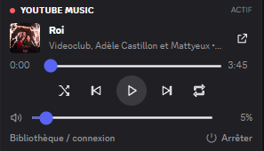

<div align="center">

### YOUTUBE MUSIC CONTROLS

<sub>PLAY · CONTROL · INTEGRATE</sub>

<sub>Experimental Vencord plugin for Discord Desktop</sub>

</div>

---

### ABOUT

**YouTube Music Controls** is an experimental [Vencord](https://vencord.dev/) plugin that brings **YouTube Music playback controls** into the Discord Desktop user panel.

It runs the official YouTube Music website in an isolated Electron session, so **no browser tab, Chrome extension, or separate music application** is required. An internal Chromium renderer remains active during playback.

> **Status — Beta.** Google account sign-in, long-running playback and compatibility with future Discord / Vencord updates are **not guaranteed**. This is not an official Google, YouTube, Discord or Vencord product.

<div align="center">
  
  <br />
  <sub>Player preview · Discord desktop theme</sub>
</div>

### TOOLS & TECHNOLOGIES

<p align="center"><sub><b>CURRENT STACK</b></sub></p>
<p align="center">
  
  
  
  
  
</p>

### IMPLEMENTED

- Compact, Discord-themed player with title, artist, cover artwork and progress bar.
- Play/pause, previous/next, shuffle, repeat, seeking and volume controls.
- Embedded YouTube Music session using Electron; no Chrome/Edge extension.
- Persistent session partition isolated from Discord's own session.
- Background playback after hiding the music window.
- Saved output volume with a guard intended to prevent sudden volume resets.
- Automatic fallback artwork if a cover is not available.

### CURRENT STATUS

| Component | Status |
|---|---|
| Plugin source | Available |
| Mock tests / syntax checks | Available |
| Full Vencord build | Automated by GitHub Actions when a version tag is pushed |
| Electron sign-in / playback | Requires real-world testing |
| Audio safety | Experimental; protect your hearing by testing at low system volume |
| Standalone `.exe` / `.dll` | Not provided — this is a Vencord plugin |

### REPOSITORY STRUCTURE

| Path | Responsibility |
|---|---|
| `src/userplugins/youtubeMusicControls/index.tsx` | Discord player, native bridge calls and controls |
| `src/userplugins/youtubeMusicControls/native.ts` | Electron session, volume persistence and artwork cache |
| `src/userplugins/youtubeMusicControls/bridge.ts` | YouTube Music page integration |
| `src/userplugins/youtubeMusicControls/style.css` | Theme-aware compact UI |
| `tests/` | TypeScript, UI and mocked Electron regression tests |
| `scripts/install-local.ps1` | Copy plugin to an existing Vencord source checkout |
| `scripts/build-release.ps1` | Build the combined Vencord desktop distribution on Windows |
| `.github/workflows/ci.yml` | Source checks on pushes and pull requests |
| `.github/workflows/release.yml` | Windows compilation and GitHub Release creation on tags |
| `docs/INSTALL_WINDOWS.md` | Windows installation instructions |
| `CHANGELOG.md` | Version history and release status |

### INSTALLATION

**Requirements:** Windows, Discord Desktop, Git, Node.js and pnpm. Custom plugins require a **Vencord source build** ([official instructions](https://docs.vencord.dev/installing/custom-plugins/)).

Clone Vencord if it is not already present:

```powershell
git clone https://github.com/Vendicated/Vencord.git "$HOME\Vencord"
```

Clone this project:

```powershell
git clone https://github.com/eymenh/youtube-music-controls.git
cd youtube-music-controls
```

Copy the plugin into the Vencord source tree:

```powershell
.\scripts\install-local.ps1 -VencordPath "$HOME\Vencord"
```

Build and inject the custom Vencord build:

```powershell
cd "$HOME\Vencord"
pnpm.cmd install --frozen-lockfile
pnpm.cmd build
pnpm.cmd inject
```

Fully restart Discord and enable **YouTube Music Controls** under **Settings → Vencord → Plugins**. Use **Start in background** and the open-player button for initial sign-in. Google may prevent sign-in in an embedded Electron window.

See [Windows installation](docs/INSTALL_WINDOWS.md) for updates, troubleshooting, and limitations.

### RELEASES

The first planned release is **[`v3.2.3-beta.1`](CHANGELOG.md)**.

When the `v3.2.3-beta.1` Git tag is pushed, GitHub Actions will try to build Vencord with this plugin on Windows and publish a **pre-release** with:

- `YouTube-Music-Controls-v3.2.3-beta.1-Windows-Vencord-dist.zip` — compiled Vencord distribution **including the custom plugin** (not a standalone executable).
- `YouTube-Music-Controls-v3.2.3-beta.1-source.zip` — plugin source, documentation and tests.
- `SHA256SUMS.txt` — checksums.
- `VENCORD_COMMIT.txt` — exact upstream Vencord revision used to build the compiled distribution.

Builds and releases are published **only after the workflow succeeds**. See [release instructions](docs/RELEASING.md). Installing compiled desktop assets still requires a compatible Vencord injection mechanism; the supported path is to build/inject from source.

### TESTING

```bash
npm install
npm test
```

Tests cover syntactic and mocked behavior, **not** a real Google account, live streaming, or the entire Discord runtime.

### SECURITY & LIMITATIONS

The plugin does not request or export passwords or Google cookies. Your session is stored by Electron in a dedicated local partition. Source code uses DOM-based integration rather than an official YouTube Music playback API; this may break without notice.

Do not distribute credentials or profile/session directories. Test first at low Windows audio volume. See [SECURITY.md](SECURITY.md).

---

### COPYRIGHT & LICENSE

Maintained by [@eymenh](https://github.com/eymenh). Source code licensed under **GPL-3.0-or-later**; see [LICENSE](LICENSE). Built distributions incorporate Vencord and remain subject to its applicable GPL terms.

Not affiliated with YouTube, Google, Discord or Vencord.
